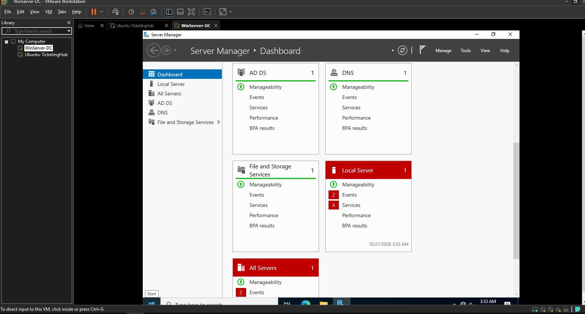
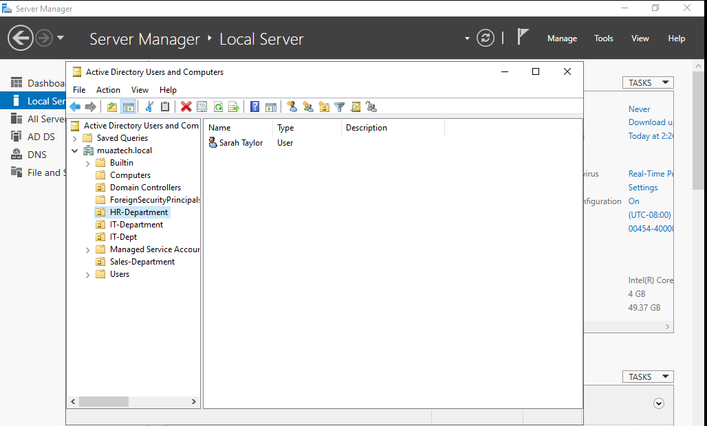
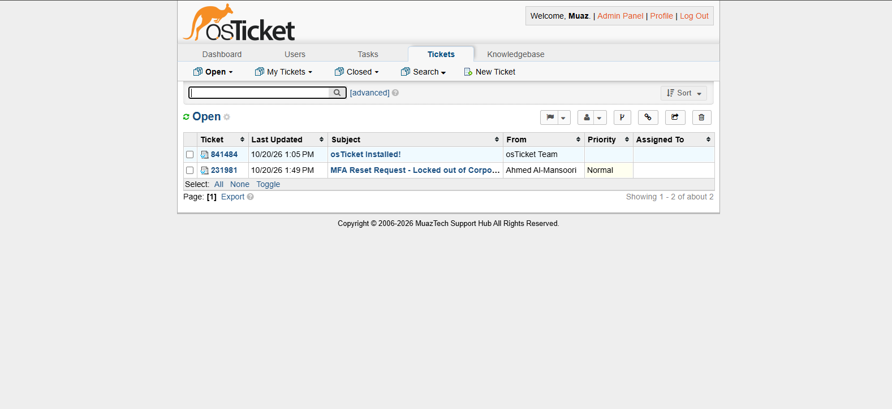
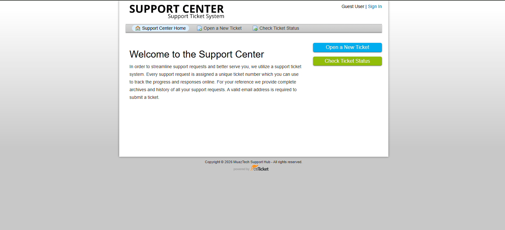
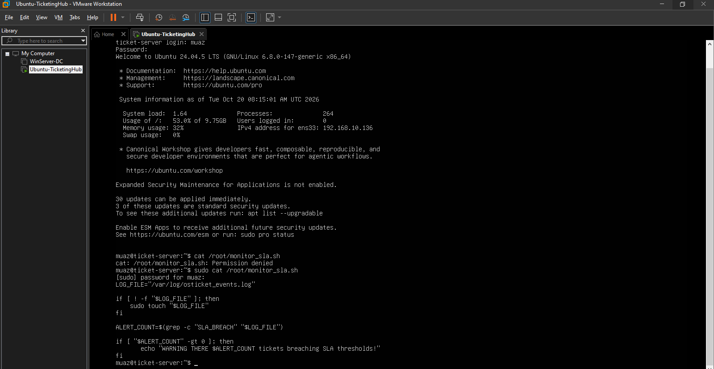

# Enterprise IT Infrastructure Lab — Active Directory + osTicket Helpdesk

A self-built enterprise lab in **VMware Workstation**: a **Windows Server 2022 domain controller** for identity and DNS, and an **Ubuntu 24.04 server** running a **LAMP stack** and the **osTicket** helpdesk, with a **Bash + cron** job that monitors SLA breaches.

Built and documented by **Muaz Naveed** (2026).



## Architecture

```
                 VMware Workstation (host-only / NAT lab network)
   ┌──────────────────────────────┐        ┌───────────────────────────────────────┐
   │ WinServer-DC                 │        │ Ubuntu-TicketingHub (ticket-server)   │
   │ Windows Server 2022          │        │ Ubuntu 24.04 LTS · 192.168.10.136     │
   │ • AD DS  (domain muaztech.local) │    │ • Apache · MySQL · PHP 8.3 (LAMP)     │
   │ • DNS                        │        │ • osTicket v1.18.1 helpdesk           │
   │ • OUs: IT, HR, Sales         │        │ • monitor_sla.sh via cron (*/5 min)   │
   │ • PowerShell user provisioning│       │                                       │
   └──────────────────────────────┘        └───────────────────────────────────────┘
```

## What I built

1. **Active Directory core** — Windows Server 2022 domain controller with **AD DS** and **DNS** for the domain `muaztech.local`.
2. **Identity automation** — a **PowerShell** script that creates the department **Organizational Units** (IT, HR, Sales) and bulk-provisions employee accounts.
3. **ITSM helpdesk** — an Ubuntu 24.04 server with a **LAMP stack** (Apache, MySQL, PHP 8.3) hosting **osTicket v1.18.1**, branded "MuazTech Support Hub": customer support portal, agent panel, departments (Support, Maintenance) and ticket statistics.
4. **Monitoring automation** — a **Bash** script, run by **cron every 5 minutes**, that counts SLA-breach events in the osTicket event log and raises a warning.

## Walkthrough

| Step | Screenshot |
|---|---|
| Domain controller with AD DS, DNS and file services | `01_windows_server_manager_dashboard.png` |
| Department OUs in Active Directory Users and Computers | `02_active_directory_ous.png` |
| Ubuntu ticket-server | `03_ubuntu_ticket_server.png` |
| osTicket installer — PHP and extension checks | `04_osticket_installer_prerequisites.png` |
| Staff login and agent ticket view | `05_…`, `06_…` |
| Customer support portal and a test ticket ("MFA Reset Request") | `07_…`, `08_…`, `09_…` |
| Dashboard statistics by department | `10_osticket_dashboard_statistics.png` |
| SLA monitoring script on the server | `11_sla_monitor_script.png` |

| Active Directory OUs | osTicket ticket queue |
|---|---|
|  |  |

| Support portal | SLA monitor script |
|---|---|
|  |  |

## Scripts

- [`scripts/monitor_sla.sh`](scripts/monitor_sla.sh) — SLA monitor (cron, every 5 minutes)
- PowerShell OU and user provisioning script — see [`scripts/README.md`](scripts/README.md)

## Challenges solved

- **Networking** — fixing subnet and routing settings between the VMs in VMware Workstation.
- **Linux permissions** — setting ownership and permissions on the osTicket web directory and the root-owned monitoring script.
- **Database setup** — creating the MySQL database and user and linking them to osTicket during installation.

## Skills demonstrated

Windows Server 2022 · Active Directory (AD DS, OUs, users) · DNS · PowerShell · Ubuntu Server · Apache · MySQL · PHP · osTicket (ITSM) · Bash scripting · cron · VMware Workstation virtualization
